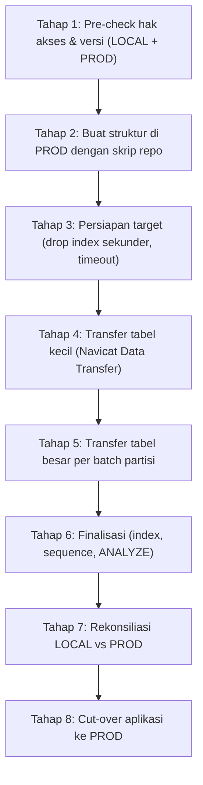

# PANDUAN MIGRASI DATA LOCAL ➜ PRODUCTION VIA NAVICAT

### FAREBOX DATA MANAGEMENT — Whoosh High Speed Railway

**Skenario:** Akses ke server production **hanya di level database** (tanpa SSH/RDP, tanpa superuser). Koneksi remote memakai **Navicat** (Premium / for PostgreSQL 15+).
**Sumber:** PostgreSQL lokal `hpr_portal` (~20,8 juta baris, ~8,5 GB).
**Target:** PostgreSQL production `hpr_portal` (kosong / baru).

---

## 0. RINGKASAN ALUR



### Skrip Pendukung (folder `database/navicat_migration/`)

| File | Dijalankan di | Fungsi |
|---|---|---|
| `01_precheck.sql` | LOCAL & PROD | Cek hak akses, versi, encoding, rentang partisi |
| `02_prepare_target_before_load.sql` | PROD | Buka timeout, drop index sekunder, kosongkan seed `users` |
| `03_post_load_finalize.sql` | PROD | Buat ulang index, sinkron sequence, `ANALYZE` |
| `04_verify_reconciliation.sql` | LOCAL & PROD | Bandingkan jumlah baris & checksum nominal per bulan |

> [!IMPORTANT]
> **Kenapa struktur tidak ikut di-copy oleh Navicat?** Navicat Data Transfer sering tidak akurat mereplikasi **tabel berpartisi** PostgreSQL (partisi bisa jadi tabel biasa, PK/partisi hilang) dan menyertakan `OWNER TO postgres` yang akan gagal karena Anda bukan superuser. Karena itu **struktur dibuat dari skrip repo**, Navicat **hanya memindahkan data**.

---

## 1. TAHAP 1 — PERSIAPAN & PRE-CHECK

### 1.1 Siapkan 2 Koneksi di Navicat

| Nama Koneksi | Host | Database | Catatan |
|---|---|---|---|
| `LOCAL-hpr` | `localhost:5432` | `hpr_portal` | User `postgres` lokal |
| `PROD-hpr` | IP/host DB prod | `hpr_portal` | User terbatas dari DBA |

Pengaturan tambahan di koneksi **PROD-hpr** (klik kanan ➜ *Edit Connection*):
- Tab **Advanced** ➜ centang **Keepalive Interval** = `60` detik (mencegah koneksi putus saat transfer berjam-jam).
- Tab **Advanced** ➜ **Encoding** = `UTF-8`.
- Tab **SSL** / **SSH** ➜ isi sesuai ketentuan DBA (jika diwajibkan).

### 1.2 Jalankan Pre-check

Buka **New Query** pada masing-masing koneksi, buka file [01_precheck.sql](./01_precheck.sql), jalankan **per blok** (blok kursor ➜ *Run Selected*).

Kriteria lulus:

- [ ] **[A]** Versi major PROD ≥ versi LOCAL dan minimal PostgreSQL 11 (dibutuhkan `PROCEDURE`).
- [ ] **[B]** `can_create_in_public = true` di PROD.
  - Jika `false` (default di **PostgreSQL 15+**), minta DBA menjalankan:
    ```sql
    GRANT USAGE, CREATE ON SCHEMA public TO <user_anda>;
    ```
- [ ] **[C]** `server_encoding` sama di kedua sisi (UTF8).
- [ ] **[E]** Di PROD belum ada tabel `hrts_*`, `users`, `upload_history` (atau sudah kosong). Di LOCAL, catat tabel yang akan dipindahkan — **abaikan `hrts_sales_legacy` / `hrts_refund_legacy`** (data duplikat ~7 GB yang tidak perlu dipindah).
- [ ] **[G]** (LOCAL) Rentang tanggal data berada di dalam **2023-10-01 s.d. 2027-12-31** (rentang partisi yang dibuat skrip). Jika ada data di luar rentang, lihat [Troubleshooting](#9-troubleshooting).
- [ ] Sisa storage di PROD ≥ **20 GB** (tanyakan ke DBA, Anda tidak bisa cek disk tanpa akses OS).

### 1.3 Bekukan Perubahan Data di LOCAL

Hentikan aplikasi lokal / proses upload Excel selama migrasi agar data tidak berubah di tengah transfer (`pm2 stop all` atau tutup `npm run dev`).

---

## 2. TAHAP 2 — BUAT STRUKTUR DI PRODUCTION

Jalankan skrip berikut di koneksi **PROD-hpr** **sesuai urutan**. Cara paling aman: **New Query** ➜ *File > Open* / paste isi file ➜ **Run** (editor Query menangani blok `DO $$ ... $$` dengan benar).

| Urutan | File | Keterangan |
|---|---|---|
| ~~—~~ | ~~`00_tuning_postgresql.sql`~~ | **LEWATI.** Butuh superuser (`ALTER SYSTEM`). Kirim file ini ke DBA sebagai rekomendasi. |
| 1 | `database/01_create_partitioned_sales.sql` | Buat `hrts_sales_p` + 51 partisi bulanan |
| 2 | `database/02_create_partitioned_refund.sql` | Buat `hrts_refund_p` + 51 partisi bulanan |
| 3 | `database/05_switch_tables.sql` | Rename `*_p` ➜ `hrts_sales` / `hrts_refund` (baris rename legacy otomatis dilewati karena `IF EXISTS`) |
| 4 | `database/03_create_summary_tables.sql` | Tabel data mart summary |
| 5 | `database/08_create_occupancy_tables.sql` | Tabel okupansi + `sp_refresh_daily_summary` versi lengkap |
| 6 | `database/07_create_views_compatibility.sql` | View kompatibilitas legacy |
| 7 | `database/09_create_users_table.sql` | Tabel `users` & `upload_history` |
| ~~—~~ | ~~`04_migrate_data.sql`, `06_*.sql`, `run_migration.ps1`~~ | **LEWATI.** Khusus migrasi internal di LOCAL. |

> [!TIP]
> **Alternatif 1 langkah:** Karena `migrate.js` hanya butuh koneksi database, Anda bisa menjalankannya dari laptop dengan `.env` diarahkan sementara ke PROD (`DB_HOST`, `DB_USER`, `DB_PASSWORD`, `DB_SSL`), lalu `npm run migrate`. Hasilnya identik dengan urutan di atas. **Kembalikan `.env` ke LOCAL setelahnya.**

Verifikasi: jalankan ulang blok **[E]** dan **[F]** dari `01_precheck.sql` di PROD. Jumlah partisi `hrts_sales` & `hrts_refund` harus **sama dengan LOCAL**, dan nama partisinya identik (`hrts_sales_2023_10` … `hrts_sales_2027_12`).

---

## 3. TAHAP 3 — PERSIAPAN TARGET SEBELUM LOAD

Di **PROD-hpr**, jalankan [02_prepare_target_before_load.sql](./02_prepare_target_before_load.sql):

- **[A]** Membuka `statement_timeout` untuk **role Anda sendiri** (tidak butuh superuser).
- **[B]** Drop index sekunder sementara (PK tetap ada ➜ aman dari duplikat saat retry). Load jadi **2–4x lebih cepat**.
- **[C]** `TRUNCATE users` — menghapus seed `admin`/`operator` bawaan skrip 09 agar tidak bentrok dengan data users dari LOCAL.

> [!WARNING]
> Setelah menjalankan skrip ini, **tutup lalu buka kembali koneksi PROD-hpr** di Navicat (klik kanan ➜ *Close Connection* ➜ *Open Connection*) agar setting timeout berlaku untuk sesi Data Transfer.

---

## 4. TAHAP 4 — TRANSFER TABEL KECIL (Navicat Data Transfer)

### 4.1 Buka Wizard

Menu **Tools ➜ Data Transfer**.

- **Source:** Connection `LOCAL-hpr` ➜ Database `hpr_portal` ➜ Schema `public`
- **Target:** Connection `PROD-hpr` ➜ Database `hpr_portal` ➜ Schema `public`

### 4.2 Pengaturan Options (WAJIB, berlaku juga untuk Tahap 5)

Klik tombol **Options** (Navicat 16/17: di halaman pertama wizard; nama opsi bisa sedikit berbeda antar versi).

| Opsi | Setting | Alasan |
|---|---|---|
| **Create tables** | ☐ **OFF** | Struktur sudah dibuat dari skrip repo |
| **Drop target objects before create** | ☐ **OFF** | Jangan sampai partisi/PK di PROD terhapus |
| Include indexes / foreign keys / triggers / rules | ☐ OFF | Tidak relevan (tanpa create table) |
| **Insert records** | ☑ **ON** | Memindahkan data |
| **Use extended insert statements** | ☑ **ON** | Multi-row INSERT, jauh lebih cepat |
| **Use complete insert statements** | ☑ **ON** | Menyertakan nama kolom ➜ aman jika urutan kolom berbeda |
| **Use transaction** | ☑ **ON** | Jika gagal, tabel tersebut di-rollback utuh (mudah diulang) |
| **Continue on error** | ☐ **OFF** | Agar error langsung terlihat, bukan data diam-diam hilang |
| **Lock target tables** | ☐ OFF | Tidak perlu |
| Create target database/schema if not exist | ☐ OFF | Butuh hak `CREATEDB` yang tidak Anda miliki |

### 4.3 Pilih Objek (Batch 1 — tabel kecil)

Centang **HANYA**:

- ☑ `users`
- ☑ `upload_history`
- ☑ `hrts_occupancy` (~485 ribu baris)
- ☑ `hrts_daily_sales_summary`
- ☑ `hrts_daily_refund_summary`
- ☑ `hrts_daily_occupancy_summary`

Jangan centang `*_legacy`, view `v_hrts_*`, atau tabel `hrts_sales` / `hrts_refund` di batch ini.

Klik **Next ➜ Start**. Setelah selesai, klik **Save** untuk menyimpan profil (misal `MIG-01-small-tables`) agar bisa diulang.

---

## 5. TAHAP 5 — TRANSFER TABEL BESAR PER BATCH PARTISI

`hrts_sales` (~19,2 juta baris) dan `hrts_refund` (~1,16 juta baris) **dipindah per partisi bulanan**, bukan sekaligus. Alasannya:

- Jika koneksi putus di tengah, cukup ulang **1 partisi** yang gagal, bukan 19 juta baris.
- Tiap partisi = 1 transaksi kecil ➜ tidak membebani WAL/memori server production.
- Progres mudah dipantau.

> [!CAUTION]
> Di daftar objek Navicat, tabel induk (`hrts_sales`) dan partisi anak (`hrts_sales_2024_01`, dst.) **sama-sama tampil**. **JANGAN pernah mencentang induk dan anak sekaligus** — data akan terkirim dua kali dan memicu error duplicate key. Di tahap ini **centang partisi anak saja**.

### 5.1 Rencana Batch (1 profil Navicat per batch)

| Profil | Objek yang dicentang |
|---|---|
| `MIG-02-refund-all` | Semua `hrts_refund_YYYY_MM` (data refund relatif kecil, bisa 1 batch) |
| `MIG-03-sales-2023` | `hrts_sales_2023_10` s.d. `hrts_sales_2023_12` |
| `MIG-04-sales-2024-H1` | `hrts_sales_2024_01` s.d. `hrts_sales_2024_06` |
| `MIG-05-sales-2024-H2` | `hrts_sales_2024_07` s.d. `hrts_sales_2024_12` |
| `MIG-06-sales-2025-H1` | `hrts_sales_2025_01` s.d. `hrts_sales_2025_06` |
| `MIG-07-sales-2025-H2` | `hrts_sales_2025_07` s.d. `hrts_sales_2025_12` |
| `MIG-08-sales-2026` | `hrts_sales_2026_01` s.d. partisi bulan berjalan |

Partisi masa depan yang kosong (misal `hrts_sales_2027_*`) boleh dilewati.

Gunakan **Options** yang sama seperti [4.2](#42-pengaturan-options-wajib-berlaku-juga-untuk-tahap-5). Pastikan pada halaman pemetaan, tiap partisi sumber dipetakan ke **partisi dengan nama yang sama** di target (default Navicat sudah begitu karena namanya identik).

### 5.2 Pantau & Catat Progres

Setelah setiap batch selesai, jalankan di **PROD** untuk memastikan jumlah baris per partisi sesuai:

```sql
SELECT tableoid::regclass AS partisi, COUNT(*) AS jumlah_baris
FROM hrts_sales            -- ganti hrts_refund untuk batch refund
GROUP BY 1 ORDER BY 1;
```

Jalankan query yang sama di **LOCAL**, bandingkan angkanya.

### 5.3 Jika Satu Batch Gagal

1. Lihat log Navicat, catat partisi yang error.
2. Kosongkan **hanya** partisi tersebut di PROD (Anda pemilik tabel, jadi boleh):
   ```sql
   TRUNCATE TABLE hrts_sales_2024_03;
   ```
3. Buka profil batch, centang ulang partisi itu saja, **Start** kembali.

> [!NOTE]
> **Estimasi durasi:** sangat bergantung pada bandwidth & latensi ke server production. Sebagai gambaran, jalur INSERT via Navicat umumnya berkisar 5.000–30.000 baris/detik. Untuk ~20 juta baris, siapkan **beberapa jam** dan lakukan di luar jam operasional (misal 22:00–05:00 WIB). Jika terlalu lambat, gunakan [Jalur Alternatif `\copy`](#7-jalur-alternatif-lebih-cepat-psql-copy-tanpa-superuser).

---

## 6. TAHAP 6 — FINALISASI DI PRODUCTION

Di **PROD-hpr**, jalankan [03_post_load_finalize.sql](./03_post_load_finalize.sql):

- **[B]** Membuat ulang seluruh index sekunder (nama identik dengan skrip asli).
- **[C]** Sinkronisasi sequence `users.id`, `upload_history.id`, `hrts_occupancy.id`. **Wajib** — tanpa ini, upload/insert baru dari aplikasi akan gagal `duplicate key value violates unique constraint`.
- **[D]** `ANALYZE` semua tabel agar planner memakai partition pruning & index secara optimal.
- **[E]** Mengembalikan setting timeout role Anda ke default.

> [!TIP]
> Proses `CREATE INDEX` pada ~19 juta baris bisa memakan 5–20 menit. Jika Navicat menampilkan timeout, jalankan statement `CREATE INDEX` satu per satu.

---

## 7. JALUR ALTERNATIF LEBIH CEPAT: `psql \copy` (TANPA SUPERUSER)

Jika Navicat terlalu lambat untuk `hrts_sales`, gunakan `\copy` dari **laptop Anda** (psql sudah tersedia di `D:\postgre\bin\psql.exe`). `\copy` berjalan di sisi **client**, sehingga **tidak membutuhkan superuser** maupun akses file di server — biasanya **5–10x lebih cepat** dari INSERT.

Contoh per partisi (PowerShell):

```powershell
$psql = "D:\postgre\bin\psql.exe"
$dir  = "D:\mig_export"; New-Item -ItemType Directory -Force $dir | Out-Null
$part = "hrts_sales_2024_01"

# 1. Export dari LOCAL ke CSV
& $psql -h localhost -U postgres -d hpr_portal `
  -c "\copy (SELECT * FROM $part) TO '$dir\$part.csv' WITH (FORMAT csv, HEADER true)"

# 2. Import ke PROD (minta password user prod)
& $psql -h <host_prod> -p 5432 -U <user_prod> -d hpr_portal `
  -c "\copy $part FROM '$dir\$part.csv' WITH (FORMAT csv, HEADER true)"
```

Ulangi untuk setiap partisi (bisa dibungkus `foreach`). Aturan yang sama berlaku: jika gagal, `TRUNCATE` partisi tersebut lalu ulangi. Lanjutkan ke Tahap 6 setelah selesai.

> [!WARNING]
> File CSV berisi data pribadi penumpang (nama, NIK/paspor). Simpan di folder terenkripsi dan **hapus setelah migrasi terverifikasi**.

---

## 8. TAHAP 7 & 8 — REKONSILIASI & CUT-OVER

### 8.1 Rekonsiliasi

Jalankan [04_verify_reconciliation.sql](./04_verify_reconciliation.sql) di **LOCAL** dan **PROD**. Export hasil grid ke Excel (klik kanan grid ➜ *Export*), bandingkan:

- [ ] `jumlah_baris` per tabel per bulan **identik**.
- [ ] `checksum_nominal` (total `after_tax_price`, `actual_refund_amount`, `total_fare`) per bulan **identik**.
- [ ] View `v_hrts_sales_legacy_compat`, `v_hrts_refund_legacy_compat` dan procedure `sp_refresh_daily_summary` ada.
- [ ] Uji fungsi procedure:
  ```sql
  CALL sp_refresh_daily_summary(CURRENT_DATE - 1);
  ```

### 8.2 Hak Akses User Aplikasi (jika berbeda dengan user migrasi)

Jika aplikasi production memakai user database **lain** dari user yang Anda pakai untuk migrasi, berikan hak akses (Anda sebagai pemilik tabel boleh menjalankan ini):

```sql
GRANT USAGE ON SCHEMA public TO <app_user>;
GRANT SELECT, INSERT, UPDATE, DELETE ON ALL TABLES IN SCHEMA public TO <app_user>;
GRANT USAGE, SELECT, UPDATE ON ALL SEQUENCES IN SCHEMA public TO <app_user>;
GRANT EXECUTE ON PROCEDURE sp_refresh_daily_summary(DATE) TO <app_user>;
```

### 8.3 Cut-over Aplikasi

1. Ubah `.env` di app server: `DB_HOST`, `DB_PORT`, `DB_USER`, `DB_PASSWORD`, `DB_SSL` sesuai PROD.
2. Restart aplikasi (`pm2 reload ecosystem.config.js`).
3. Login, cek dashboard, laporan bulanan, dan coba 1 upload Excel kecil.
4. **Ganti password akun `admin`/`operator`** jika masih memakai password default dari skrip 09.

### 8.4 Sinkronisasi Delta (Opsional)

Jika ada data baru masuk ke LOCAL setelah migrasi dimulai, gunakan **Tools ➜ Data Synchronization** di Navicat (perbandingan berbasis Primary Key), **batasi hanya ke partisi bulan berjalan** dan tabel kecil. Jangan membandingkan seluruh 19 juta baris — sangat berat.

---

## 9. TROUBLESHOOTING

| Pesan Error | Penyebab | Solusi |
|---|---|---|
| `permission denied for schema public` | PG15+ mencabut hak `CREATE` default di `public` | Minta DBA: `GRANT USAGE, CREATE ON SCHEMA public TO <user>;` |
| `must be superuser to execute ALTER SYSTEM` | Menjalankan `00_tuning_postgresql.sql` | Lewati; serahkan ke DBA |
| `must be owner of table ...` | Tabel di PROD dibuat oleh user lain | Minta DBA `ALTER TABLE ... OWNER TO <user>` atau minta grant terkait |
| `no partition of relation "hrts_sales" found for row` | Ada data di luar rentang 2023-10 s.d. 2027-12 | Buat partisi tambahan, contoh: `CREATE TABLE hrts_sales_2023_09 PARTITION OF hrts_sales FOR VALUES FROM ('2023-09-01') TO ('2023-10-01');` |
| `duplicate key value violates unique constraint "pk_hrts_sales_p"` | Partisi sudah terisi sebagian / induk & anak dicentang bersamaan | `TRUNCATE` partisi tsb, ulangi; pastikan hanya partisi anak yang dicentang |
| `canceling statement due to statement timeout` | Timeout server | Jalankan `02_prepare...` blok [A], lalu reconnect koneksi |
| `server closed the connection unexpectedly` | Koneksi putus (firewall/idle) | Aktifkan Keepalive di Navicat, perkecil batch, atau pakai `\copy` |
| `invalid byte sequence for encoding "UTF8"` | Encoding client tidak sesuai | Set Encoding koneksi Navicat = UTF-8 |
| Insert baru dari aplikasi gagal `duplicate key ... users_pkey` | Sequence belum disinkronkan | Jalankan ulang blok [C] `03_post_load_finalize.sql` |
| Laporan lambat setelah migrasi | Statistik planner belum diperbarui / index belum dibuat | Jalankan ulang `03_post_load_finalize.sql` |

---

## 10. ROLLBACK

Karena target PROD awalnya kosong, rollback cukup dengan mengosongkan data dan mengulang dari Tahap 3:

```sql
-- Jalankan di PROD. Hanya data yang dihapus, struktur & partisi tetap.
TRUNCATE TABLE hrts_sales, hrts_refund, hrts_occupancy,
               hrts_daily_sales_summary, hrts_daily_refund_summary, hrts_daily_occupancy_summary,
               users, upload_history
RESTART IDENTITY;
```

> [!CAUTION]
> Perintah di atas **menghapus seluruh data** di tabel-tabel tersebut. Pastikan Anda terhubung ke koneksi yang benar (cek judul tab Query Navicat) dan **jangan pernah** menjalankannya setelah aplikasi production sudah aktif menerima data.

Data di LOCAL tidak pernah diubah oleh seluruh proses ini, sehingga selalu tersedia sebagai sumber cadangan.
